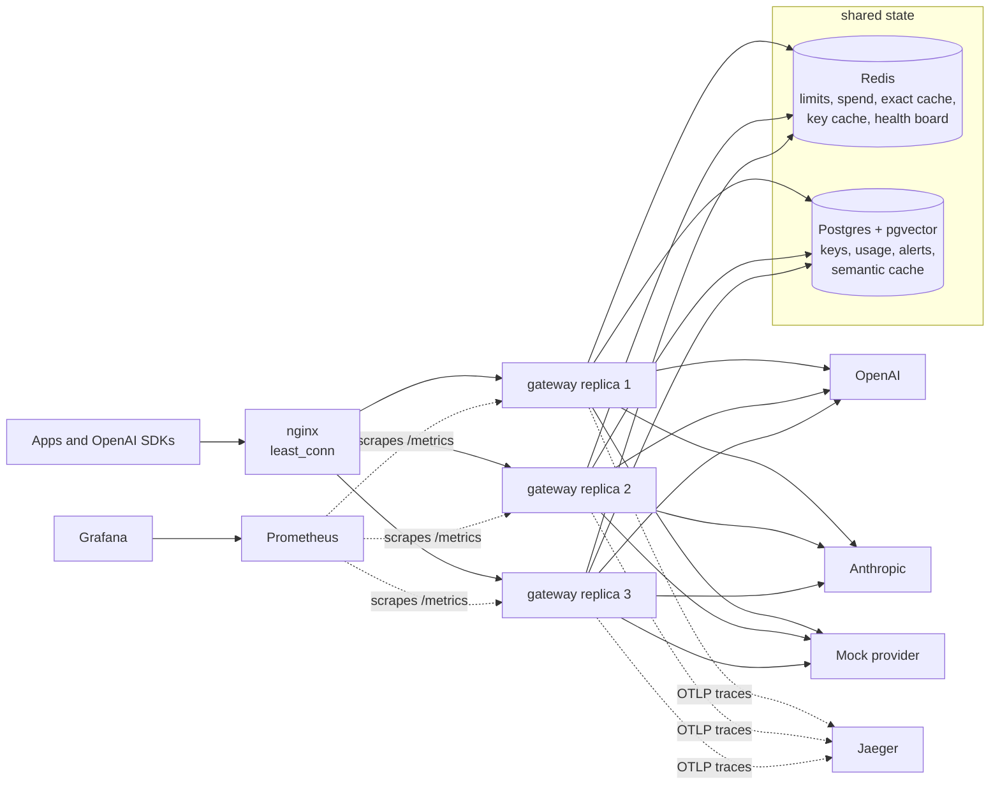
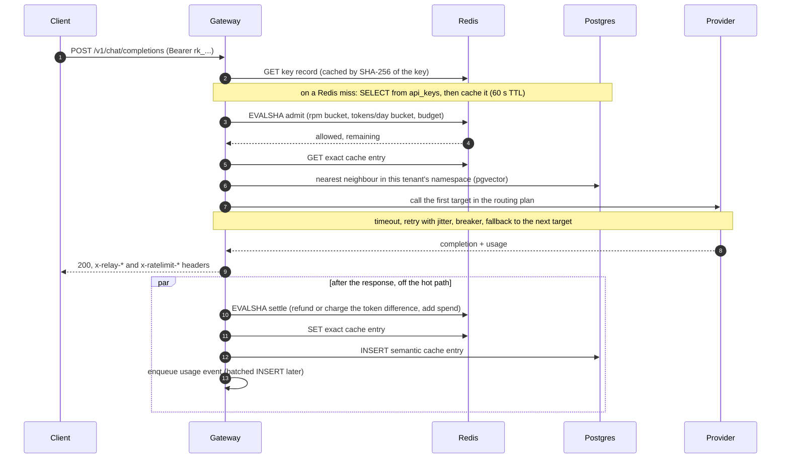

# Relay: design

Relay is a self-hostable LLM gateway. Applications send OpenAI-format chat completions to
one endpoint; Relay authenticates the caller, enforces its limits, answers from cache when
it can, picks a provider, survives provider failures, and meters tokens and cost. This
document explains how, and why it is built that way.

- [Requirements](#requirements)
- [Capacity estimate](#capacity-estimate)
- [Architecture](#architecture)
- [Request lifecycle](#request-lifecycle)
- [Data model](#data-model)
- [Rate limits and quotas](#rate-limits-and-quotas)
- [Routing and reliability](#routing-and-reliability)
- [Caching](#caching)
- [Metering and budgets](#metering-and-budgets)
- [Observability](#observability)
- [Failure modes](#failure-modes)
- [Performance](#performance)
- [Trade-offs](#trade-offs)
- [What I would do next](#what-i-would-do-next)

## Requirements

**Functional**

- `POST /v1/chat/completions`, OpenAI-compatible, streaming (SSE) and non-streaming;
  `GET /v1/models`. Any OpenAI SDK works by changing `base_url`.
- Providers: OpenAI, Anthropic (Messages API, translated both ways) and a mock provider
  with controllable latency and failures.
- Routes map a public model name to provider targets under a policy: priority, weighted,
  cheapest, lowest-latency.
- Reliability: timeouts, retries with jitter, a circuit breaker per provider, fallback.
- Per-key limits: requests/minute, tokens/day and an optional monthly budget, answered with
  `429` and `Retry-After`.
- Caching: exact, plus semantic (embedding similarity), with hit-rate metrics.
- Metering: tokens and cost per key, route and provider, daily roll-ups, budget alerts.
- Admin API: create, edit and revoke keys, read usage, alerts and provider health. A
  dashboard on top of it.

**Non-functional**

- Low overhead: a few milliseconds added at the median, measured, not assumed.
- Horizontal scale: replicas are stateless; any replica can serve any request.
- Limits are exact across replicas: N replicas must not admit N times a key's limit.
- Graceful degradation: losing Redis, Postgres or a provider should cost features, not
  the whole gateway.
- Observable: metrics, traces and logs that answer "why was this request slow or denied".
- Runs on free tiers: one small container plus managed Postgres (Neon) and Redis (Upstash).

## Capacity estimate

A worked example for a mid-sized organisation: **10 million requests a day**.

| Quantity | Estimate |
|---|---|
| Average rate | 10M / 86,400 s ≈ **115 req/s** |
| Peak (3x average) | ≈ **350 req/s** |
| In-flight requests at peak | LLM calls take seconds; at an average of 2 s, 350 × 2 = **700 concurrent upstream calls**. This rules out a thread per request and is why the gateway is async end to end. |
| Redis operations | Per request: key lookup, admission script, settlement script, exact cache GET (+ SET on a miss): 4–5 ops, about **1,750 ops/s** at peak. One Redis node handles ~100k simple ops/s, so this is under 2% of one node. |
| Usage rows | 10M/day at ~250 B ≈ **2.5 GB/day**, 75 GB at the default 30-day retention. Written in batches of up to 500 rows, so a few inserts per second, not 115. Dashboards read `usage_daily` (one row per day × key × route × provider), never the raw events. |
| Semantic cache | With a 1 h TTL and, say, half of all prompts new: 115 × 0.5 × 3,600 ≈ **200k live rows** × ~3.5 KB (1.5 KB vector + ~2 KB response) ≈ **0.7 GB** plus the HNSW index. |
| Gateway replicas | Measured below: one replica (one Python process, ~1 vCPU) sustains 200 req/s when the provider is called and about 100 req/s for new prompts with the cache on. If half of the 350 req/s peak are new prompts: 175/200 + 175/100 ≈ 2.6 replicas of CPU, so **4 replicas** with headroom. |
| Postgres for the semantic cache | About 11 ms of database time per new prompt under load (2 ms each for the HNSW search and insert when idle): 175 new prompts/s needs roughly **2 dedicated vCPUs** for Postgres. |

The expensive resources are the providers, not the gateway: at 350 req/s with ~1,000
tokens per request, the monthly token bill dwarfs any infrastructure here. That is why the
features that save tokens (caching, cheapest routing, budgets) matter more than shaving
another millisecond.

## Architecture

The gateway is one Python package, `relay`, in four layers. The dependency rule is
enforced in CI by import-linter, so it cannot erode:

| Layer | Contains | May import |
|---|---|---|
| `api` | FastAPI routes, auth dependencies, error envelope, middleware | services, domain |
| `services` | The request pipeline, quotas, cache policy, resilience, metering, and the *ports* (protocols) for everything external | domain only: never FastAPI, Redis, SQLAlchemy or HTTP clients |
| `domain` | Pure logic: request and completion models, routing policies, circuit breaker, token-bucket maths, cache keys, cost | nothing outside the standard library and pydantic |
| `infra` | Adapters implementing the ports: Redis, Postgres, provider HTTP clients, embedders | domain, services' ports |

`bootstrap.py` wires adapters into services (constructor injection, no globals). Tests swap
in fakes for every port, so the whole pipeline (routing, retries, breakers, limits, cache,
metering) runs in-process in milliseconds; integration tests then run the same flows
against real Redis, Postgres and the mock provider over HTTP.

## Request lifecycle

A non-streaming request whose answer is not cached:

Streaming differs in three ways. The gateway opens the upstream stream and waits for the
**first event before committing the response to the client**, so connection errors,
`429`s and `5xx`s can still fall back to another target. After that, events are relayed as
they arrive; a failure mid-stream ends the stream with an error event, because the client
already has part of an answer. Usage comes from the provider's final event when it sends
one, otherwise it is estimated from the text, and settlement runs in a `finally` block, so
a client that disconnects half-way is still billed for what was generated.

## Data model

**Postgres** (schema in [`src/relay/infra/postgres/tables.py`](../src/relay/infra/postgres/tables.py), migrated by Alembic):

| Table | Purpose | Notes |
|---|---|---|
| `api_keys` | One row per gateway key | Only the SHA-256 of the key is stored; the plaintext is returned once at creation. Limits, budget, allowed models, `revoked_at`. |
| `usage_events` | One row per served request | Append-only, no foreign key (cheap inserts; history outlives keys). Indexed by time and by (key, time). Deleted after `USAGE_RETENTION_DAYS`. |
| `usage_daily` | Per day × key × route × provider totals | Upserted additively in the same transaction as the events it summarises, so it always agrees with them. |
| `budget_alerts` | 50/80/100% budget crossings | A unique (key, period, threshold) constraint makes "alert once" hold across replicas. |
| `semantic_cache` | Cached answers with their prompt embedding | `vector(384)` with an HNSW (cosine) index, a namespace column and an expiry. |

**Redis** (all keys of one API key share a `{key-id}` hash tag, so the Lua scripts also work on Redis Cluster):

| Key | Type | Purpose |
|---|---|---|
| `relay:{id}:rpm`, `relay:{id}:tpd` | hash `{v, t}` | Token buckets: level and last refill time |
| `relay:{id}:spend:YYYY-MM` | integer | Spend this month in micro-USD |
| `relay:cache:<sha256>` | string | Exact cache entry (TTL) |
| `relay:key:<sha256>` | string | Cached key record or a negative result (TTL) |
| `relay:health:<replica>` | string | Each replica's breaker states and latencies (TTL) |

## Rate limits and quotas

Each key has two **token buckets**: requests per minute and tokens per day. A bucket holds
up to `limit` tokens and refills continuously (`limit` per window), which allows short
bursts but enforces the average. A monthly **spend** counter backs an optional hard
budget.

**Admission is one Lua script** ([`rate_limiter.py`](../src/relay/infra/redis/rate_limiter.py)).
It refills both buckets to the current time, checks the request bucket, the token bucket
and the budget, and only if all three pass, takes from both buckets. Redis runs a script
atomically, so:

- **Limits are exact across replicas.** There is no read-then-write race between replicas;
  every admission for a key is serialised in Redis. The compose CI job proves it: a burst
  of 150 requests through nginx at a 30/minute key, spread across 3 replicas, admits
  exactly 30.
- **All-or-nothing.** A request denied for tokens does not consume a request slot.
- **One clock.** Refill uses Redis's `TIME`, not each replica's clock, so drift between
  machines cannot hand out extra tokens.

**Reserve, then settle.** The real token count is only known after the provider answers,
so admission reserves an estimate (prompt tokens estimated from the text, plus
`max_tokens` or a default of 256), and a second script settles: it refunds the difference
or charges the overrun (the bucket may go briefly negative; later requests repay that debt
before being admitted), and adds the cost to the spend counter. Cache hits and failed
requests refund their whole token reservation but still count as a request.

Denials return `429` with `Retry-After` computed from the bucket's refill rate (the time
until one request, or the needed tokens, are available), plus `x-ratelimit-*` headers on
every response.

**When Redis is down**, the default is to **fail open** (`RATE_LIMIT_FAIL_OPEN=true`):
requests are served without limits and a metric counts it. An outage of the limiter should
not become an outage of every application behind the gateway, and the providers' own limits
and the budget alerts still apply. Deployments that sell quota can set it to `false` and
get a `503` instead.

## Routing and reliability

A **route** maps a public model name (`relay-mock`, `gpt-5-mini`, ...) to targets
(provider + provider model, with prices and weights) under a policy. A policy only decides
**order**; every target stays in the plan as a fallback:

| Policy | Order |
|---|---|
| `priority` | As configured |
| `weighted` | Random, proportional to weight, without replacement (Efraimidis–Spirakis), so fallbacks are weighted too |
| `cheapest` | By estimated cost of *this* request (estimated prompt tokens and `max_tokens` × each target's prices) |
| `lowest-latency` | By an EWMA of each target's observed latency (separately for streaming and not), with 5% random exploration so a target that was slow once is re-measured instead of starved |

The **resilient executor** ([`resilience.py`](../src/relay/services/resilience.py)) walks the plan:

1. Ask the provider's circuit breaker for a permit; if open, skip to the next target.
2. Call with a timeout: the provider's own timeout, cut to what is left of the request's
   overall deadline (`REQUEST_TIMEOUT_S`), so retries can never exceed it.
3. On a retryable failure (timeout, connection error, `429`, `5xx`), retry the same
   target up to `max_retries` times with **exponential backoff and full jitter**
   (`uniform(0, min(cap, base × 2^n))`), so many clients do not retry in lockstep. A
   short `Retry-After` from the provider is honoured; a long one moves on to the next
   target immediately.
4. A non-retryable failure (`400`, `401`, `403`, `404`) stops the whole plan: another
   provider would reject the same request, and it says nothing about provider health.

The **circuit breaker** uses a count-based sliding window: it opens when at least
`min_calls` of the last `window_size` calls ran and the failure rate reached the threshold
(defaults: 5 of the last 20, 50%). After `open_seconds` (30) it lets up to 2 trial calls
through (half-open); success closes it, a failure re-opens it. Breakers are **per
replica**, like Envoy's outlier detection: decisions cost no network hop and keep working
without Redis. The cost is that each replica learns about a failing provider from its own
traffic, a handful of requests each. Each replica publishes its breaker states to Redis so
the dashboard shows a merged view, which is only displayed, never used for decisions.

## Caching

Two layers, checked in order, both partitioned by **key owner** so one tenant's answers
are never served to another:

**Exact** (Redis): the key is a SHA-256 of the canonical request: model alias, messages
and every generation parameter (`temperature`, `max_tokens`, tools, ...). One `GET`.

**Semantic** (Postgres + pgvector): the conversation's text is embedded and the nearest
cached entry is found by cosine similarity, within a **namespace** that pins everything
except the wording: owner, model and parameters, embedder, and the prompt's
**number signature** (its numbers, sorted). Embeddings place "what does HTTP 429 mean" and
"what does HTTP 503 mean" almost on top of each other, but the answer to one is wrong for
the other, so prompts with different numbers are never compared. Only short, text-only,
tool-free conversations qualify.

**Thresholds come from measurement, not intuition.**
[`benchmarks/semantic_threshold.py`](../benchmarks/semantic_threshold.py) sweeps 55
labelled pairs (same intent vs different intent):

- The default **hashing** embedder (feature-hashed words, bigrams and trigrams; no model,
  under a millisecond) has its worst different-intent pair at 0.83 and no false positives
  from 0.84 up; it ships at **0.88**. It catches formatting and small edits, not
  paraphrases.
- **bge-small** (local ONNX) catches paraphrases but scored one different-intent pair at
  0.995: no threshold is free of false positives on this set. It ships at a strict 0.97,
  and the trade-off is documented rather than hidden.

**What is never cached:** errors, interrupted streams, tool calls, `n > 1`, and requests
with `Cache-Control: no-store` (`no-cache` skips the lookup). Hits return a fresh
completion id and an `x-relay-cache: exact|semantic` header (plus the similarity).

**Invalidation.** Entries expire by TTL (`CACHE_TTL_S`, 1 h by default; Redis evicts
least-recently-used entries under memory pressure). Anything that changes the answer
(model, parameters, embedder) is part of the key or namespace, so it misses instead of
serving something stale. A version prefix in every key retires all entries at once when
the format changes, and `POST /admin/cache/flush` clears both layers.

**Two performance details found under load**:

- A semantic hit is **promoted** into the exact layer, so the next identical request is one
  Redis `GET` instead of an embedding plus a vector search.
- Lookups were prepared statements, and after five runs Postgres switched to a generic plan
  that assumed a tiny namespace and brute-forced it through the btree index: ~60 ms at
  6,000 rows instead of 4 ms through HNSW. Migration 0004 sets `force_custom_plan` and the
  HNSW search settings (iterative scans, so a filtered search keeps walking the graph until
  it finds rows in the namespace) as database defaults, which also removed a `SET` round
  trip from every lookup.

## Metering and budgets

Every served request (including cache hits, at zero cost, with the money they saved)
becomes a `UsageEvent`. The **recorder** never blocks the request: `record()` appends to a
bounded in-memory queue, and a background task writes batches (up to 500 rows, at least
every second) in one transaction that inserts the events and upserts `usage_daily`.

The trade-off is durability: events in the buffer are lost if the process is killed
(a graceful shutdown flushes them). If Postgres is slow, the queue fills, then drops events
and counts them in `relay_usage_events_dropped_total` rather than growing without bound or
slowing requests down. A failed batch is retried. For a gateway, protecting request
latency is the right call; billing-grade metering would write to a durable log (Kafka,
Redis Streams) first.

**Budgets** have two parts:

- **Enforcement** (optional per key) happens at admission, from the Redis spend counter.
  That counter is updated atomically by the settlement script, so it is exact across
  replicas and needs no database read.
- **Alerts** fire when spend crosses 50%, 80% and 100% of the monthly budget. Settlement
  returns the counter's value before and after the increment, so exactly one request
  crosses each threshold even with many replicas. The alert is inserted under a unique
  constraint, so it is recorded once, then optionally posted to a webhook.

## Observability

- **Metrics** (Prometheus, `/metrics` on every replica): requests by route, status and
  cache result; latency; **gateway overhead** (request time minus time waiting on
  providers); time to first token; upstream attempts, retries, fallbacks; breaker state
  and transitions; rate-limit denials by reason; cache lookups by layer; tokens, cost and
  money saved by caching; usage-queue depth and drops; budget alerts.
- **Grafana** is provisioned with a dashboard over those metrics (generated from code in
  `ops/grafana/build_dashboard.py`).
- **Traces** (OpenTelemetry → Jaeger): one trace per request with spans for the Redis
  calls, the cache lookup and embedding, the Postgres queries and every upstream attempt
  (provider, model, attempt number, breaker probe, failure kind). `traceparent` is
  forwarded to providers. Sampling is configurable (`OTEL_TRACES_SAMPLER_RATIO`).
- **Logs**: structured JSON, one access line per request (request id, method, path,
  status, duration). The request id is accepted from or returned as `x-request-id`, and
  the same request's business detail (key, route, provider, cache result, tokens, cost,
  attempts, replica) is in `usage_events`, browsable through `/admin/usage/events` and the
  dashboard.
- **Health**: `/healthz` (the process is up) and `/readyz` (Redis and Postgres answer
  within 2 s), so a load balancer stops routing to a replica that lost its dependencies
  without restarting it.

## Failure modes

| Failure | What happens | Why |
|---|---|---|
| A provider times out or returns 5xx | Retried with backoff, then the next target; after enough failures the breaker opens and the provider is skipped for 30 s, then probed | Fail fast instead of making every request wait for a dead provider's timeout |
| Every target fails | `502` (`503` if every breaker is open, `504` past the deadline) with an OpenAI-style error body | Clients get a well-formed error they already know how to handle |
| Stream fails mid-way | Error event, stream closed; tokens so far are billed | Can't fall back after the client received part of an answer |
| Redis down | Limits fail open (configurable), caches miss, key lookups go to Postgres; `/readyz` reports it. A refused connection fails instantly; an unreachable host costs up to the 2 s socket timeout per Redis call | Degrade features, keep serving |
| Postgres down | Already-cached keys keep working from Redis for their TTL; usage events buffer, then drop with a metric; the semantic cache misses; new keys can't authenticate | The hot path needs Postgres only on a key-cache miss |
| A replica dies | nginx sends new requests to the others (a failed connection is retried on another replica; a POST already delivered is never replayed, so nothing is billed twice); its health snapshot expires from Redis; its buffered usage events are lost | Replicas are stateless; nothing to recover |
| Clock drift between replicas | No effect on limits | Buckets use Redis server time |
| Thundering herd after a provider outage | Full-jitter backoff spreads retries; half-open allows only 2 probes | No synchronized retry wave |
| Cache poisoning across tenants | Impossible by construction | Owner is part of every cache key and namespace |

## Performance

Measured with k6 on one 4-vCPU machine running everything (k6, nginx, gateways, the mock
provider with a fixed 50 ms latency, Redis, Postgres). Full results, commands and machine
details: [`benchmarks/results/2026-10-23`](../benchmarks/results/2026-10-23/README.md).

| Request path | 1 replica sustained | 3 replicas sustained | Limited by |
|---|---|---|---|
| Cache bypassed (provider call every time) | 200 req/s (peak 232) | 400 req/s (peak 478) | Gateway CPU |
| Exact cache hit | 200 req/s, p50 6.4 ms (peak 250) | 400 req/s, p50 5.4 ms (peak 509) | Gateway CPU |
| New prompt, cache on | 100 req/s (peak 107) | 100 req/s (peak 156) | Postgres (HNSW search + insert) |

**Overhead.** At 100 req/s with the cache bypassed, the gateway adds 4.7 ms at p50 and
7.7 ms at p95 end to end (including an extra nginx hop). Of that, 0.8 ms p50 is the
request pipeline after authentication (admission, routing, building the response; the
`relay_gateway_overhead_seconds` metric, which subtracts time waiting on the provider); the
rest is HTTP parsing, the key lookup, the extra network hop and queueing.

**Where the CPU goes.** A cache hit costs a replica almost as much CPU as a full provider
call: per request the gateway still authenticates the key, runs the admission script,
settles the reservation and meters the request (three to four Redis round trips plus the
framework), and the upstream call itself is only about a sixth of the CPU after the switch
to aiohttp. That is why hits peak at 250 req/s per replica rather than far above the
bypassed path. Past saturation a replica queues work in its event loop and latency jumps to
seconds (see [load shedding](#what-i-would-do-next)).

**The default path for new prompts** costs Postgres about 11 ms per request under load
(`pg_stat_statements`: 6.9 ms for the vector search, 4.0 ms for the insert, 0.03 ms for
metering), so on this shared machine it is capped by the database, and adding gateway
replicas does not raise it. In production the database would get its own cores, and the
[write path](#what-i-would-do-next) has cheaper options.

**How the numbers got there.** The first measurement saturated one replica at about
90 req/s. `py-spy` showed 64% of the CPU inside httpx/httpcore, 28% of it the connection
pool checking every idle socket for readability on each request; switching the upstream
client to aiohttp brought the same replica to about 230 req/s. On the cache path,
`EXPLAIN ANALYZE` found Postgres using a generic plan that scanned a whole tenant's entries
(68 ms at 6,000 rows instead of 4 ms through HNSW), fixed by migration 0004, and a semantic
hit is now promoted to the exact cache. Measured but rejected: an UNLOGGED cache table gave
13% more insert throughput, not worth losing the cache on every Neon compute restart. The
measurements are in
[`diagnostics.md`](../benchmarks/results/2026-10-23/diagnostics.md).

## Trade-offs

**Central limits in Redis vs local limits.** Local token buckets (each replica gets
limit / N) need no network hop, but are only exact if traffic is perfectly balanced and N
is fixed. Central counters cost a Redis round trip per request and are exact for any
number of replicas and any balancing. For a product that sells quota, exactness wins.
At much larger scale the next step is batching: replicas lease small blocks of tokens
from Redis and admit locally, trading a bounded overshoot for fewer round trips.

**Per-replica breakers vs a shared breaker.** Sharing state in Redis would let one replica
warn the others, but makes the reliability mechanism depend on another dependency, and
breaker decisions would then need a network call on every request. Per-replica breakers
react within a few requests and keep working when Redis does not.

**Fail open vs fail closed.** Covered above: availability by default, configurable.

**Exact before semantic.** The exact layer is one Redis GET; the semantic layer costs an
embedding plus a vector search. Checking exact first makes the common repeat cheap, and
promotion makes semantic repeats cheap after the first one.

**Semantic cache in Postgres (pgvector) vs a vector database.** One fewer system to run,
shared by every replica, available on Neon's free tier, and fast enough at this scale
(milliseconds through HNSW). A dedicated vector store becomes worthwhile at tens of
millions of entries or when filtering needs outgrow a namespace column.

**Python.** FastAPI and asyncio make the gateway easy to read and extend, and the work is
I/O-bound: the provider call dominates latency. The price is CPU per request: one process
uses one core, so throughput scales by adding replicas (or processes), which the design
already assumes. A Go or Rust data plane would do several times more per core.

**Usage metering in memory first.** Covered above: latency over durability.

## What I would do next

- **Token-block leasing** for rate limits, to remove the per-request Redis round trip at
  very high rates while keeping a bounded overshoot.
- **Durable usage pipeline** (Redis Streams or Kafka) for billing-grade metering.
- **Per-tenant routing rules and model allow-lists** managed from the dashboard.
- **Request hedging** for latency-critical routes: after the p95 latency, send a second
  attempt to another target and take whichever answers first.
- **Prompt-prefix (provider) caching** awareness: route repeat long prompts to the same
  provider to benefit from its own prompt cache, and price them accordingly.
- **Load shedding.** Past its CPU capacity a replica queues work in its event loop: latency
  climbs into seconds and, eventually, waits for a Redis connection time out. A cap on
  requests in progress per replica, or shedding on event-loop lag, would answer the excess
  with a fast `503` and `Retry-After` instead, and give an autoscaler a clean signal.
- **A cheaper semantic-cache write path.** Every new prompt costs Postgres an HNSW insert
  and a search (about 2 ms each when idle, more under load), and the database is shared by
  every replica, so it caps the default path no matter how many replicas run. Options, in
  order of effort: store a prompt only the second time it is seen, batch inserts,
  `halfvec` (16-bit) vectors, partition the table by expiry hour so old entries are dropped
  as partitions instead of deleted and vacuumed, or a dedicated vector store.
- **A breaker around Redis**, so an unreachable (not just refusing) Redis costs one timeout,
  not one per call, before the gateway switches to its degraded mode.
- **Multi-process workers** per container to use every core of larger instances.
